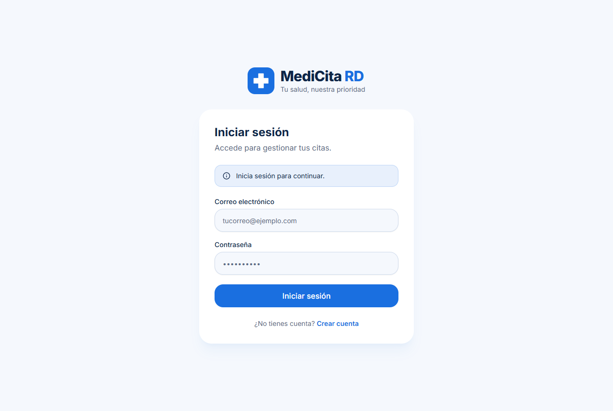
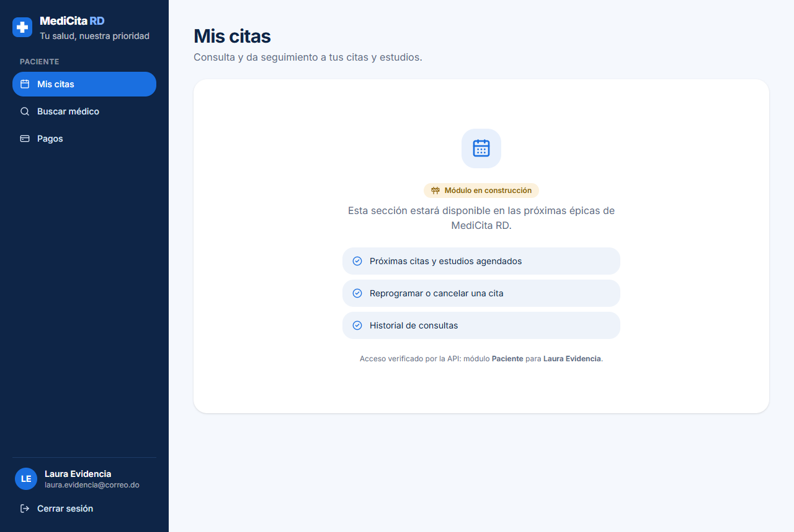
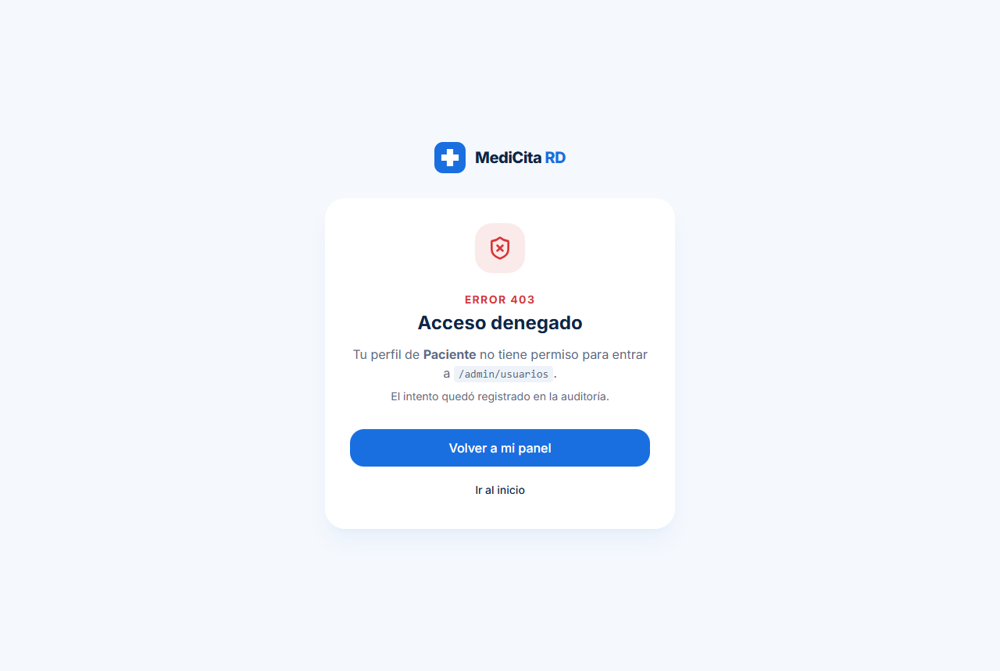
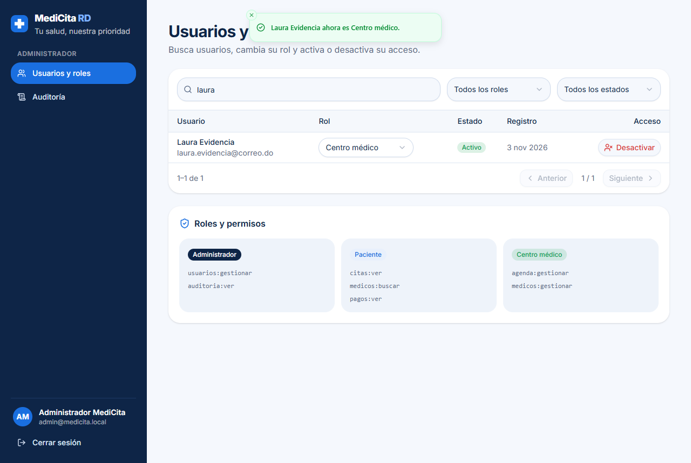
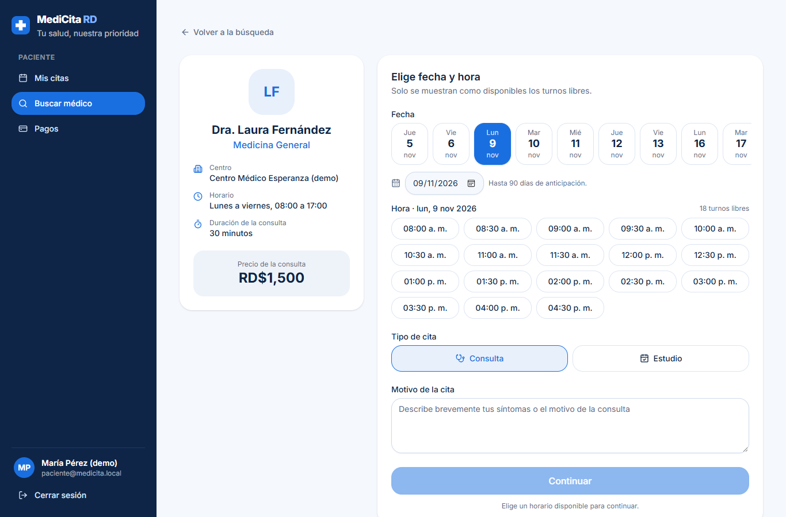
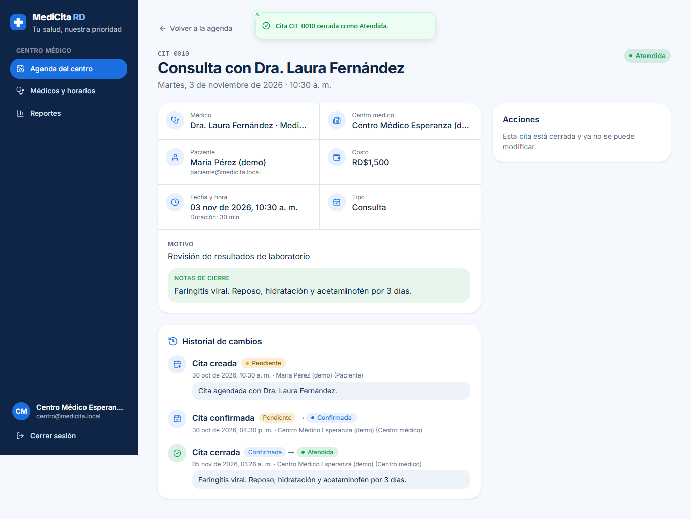
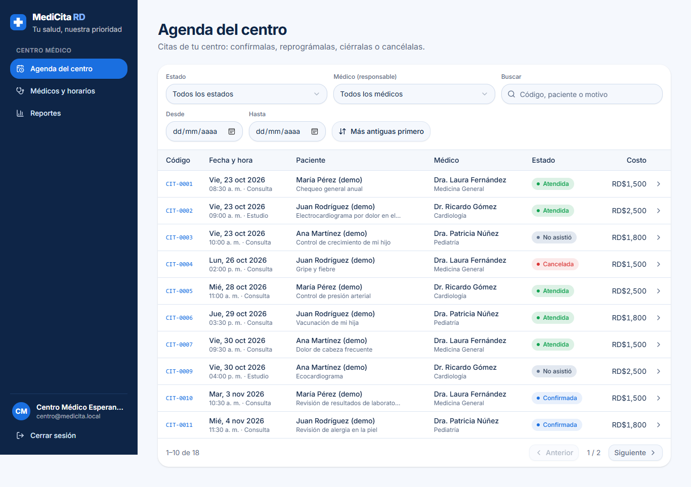
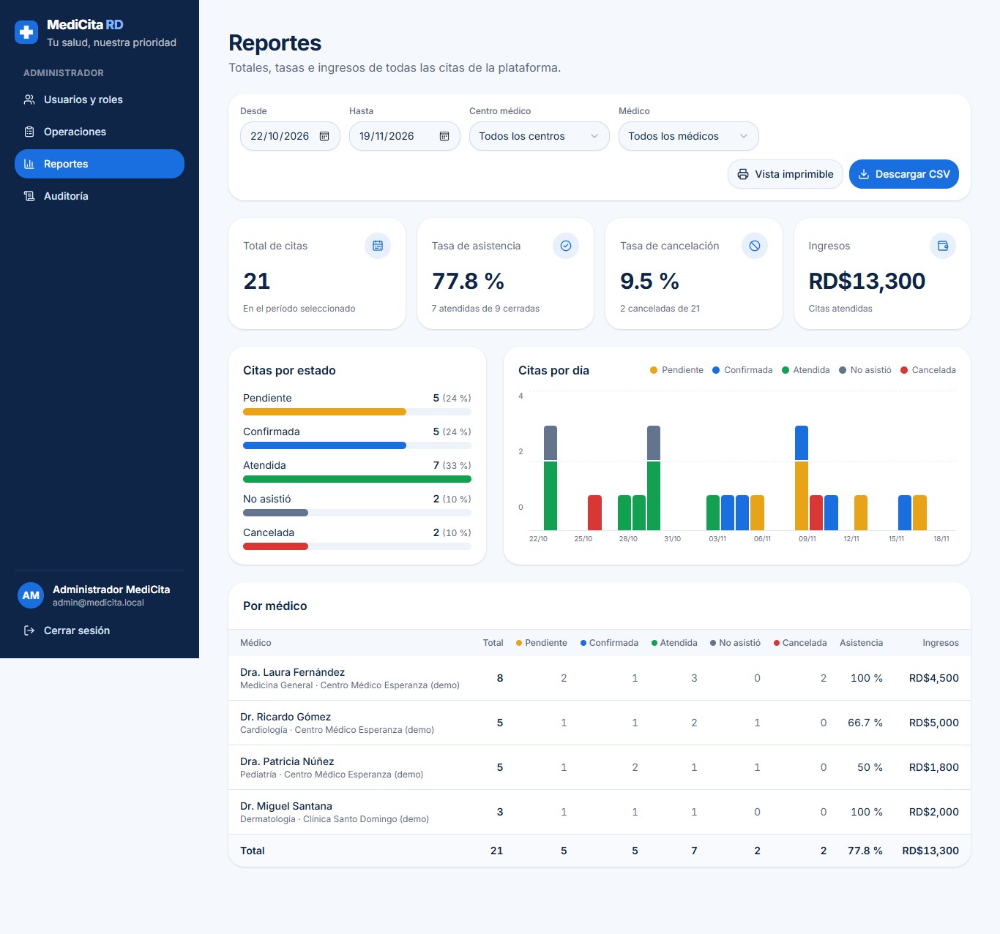

# MediCita RD

> **Tu salud, nuestra prioridad.**

## Equipo

- Adrián Lebrón
- Jael Jiménez
- Manuel Custodio
- Albery Lara

Universidad APEC (UNAPEC)

MediCita RD es una aplicación web para agendar citas médicas y estudios, pagarlos en línea y darles seguimiento en República Dominicana.

Tiene tres perfiles:

| Rol | Qué hace |
|---|---|
| **Paciente** (usuario principal) | Busca médicos, agenda, reprograma o cancela, y ve sus citas con su historial. |
| **Centro médico** | Publica médicos, horarios y precios; gestiona su agenda (confirma, reprograma, cierra y cancela) y ve el reporte de su centro. |
| **Administrador** | Gestiona usuarios, roles y permisos; consulta todas las citas (Operaciones), el reporte global y la auditoría. |

Este repositorio contiene:

- **Épica 1: Gestión de Usuarios y Accesos.** Registro, inicio y cierre de sesión, asignación de roles, restricción por perfil, activación y desactivación de cuentas, y auditoría de las operaciones.
- **Épica 2: Gestión Operativa (citas médicas).** Médicos y horarios del centro; búsqueda por especialidad; agendar en turnos libres; consultar, actualizar, reprogramar, confirmar, cerrar y cancelar citas con reglas de negocio (R1 a R10); filtros por estado, fecha y responsable; historial de cambios, y reporte de operaciones con descarga CSV.

El módulo de pagos sigue como pantalla provisional.

## Pantallas

| Rol | Pantallas |
|---|---|
| Paciente | **Mis citas** (Próximas e Historial) → detalle con historial, reprogramar, editar y cancelar · **Buscar médico** (por especialidad) → perfil → fecha y hora libres → confirmación con resumen y costo · Pagos (provisional) |
| Centro médico | **Agenda del centro** (filtros por estado, fechas y médico) → detalle con confirmar, reprogramar, cerrar, cancelar y línea de tiempo · **Médicos y horarios** (agregar, editar, activar y desactivar) · **Reportes** (solo su centro) |
| Administrador | **Usuarios y roles** · **Operaciones** (todas las citas con filtros por estado, fecha, centro y médico) · **Reportes** (tarjetas, gráficos, tabla por médico, CSV y vista imprimible) · **Auditoría** |

El guion de la demo de cada épica está en [docs/DEMO.md](docs/DEMO.md).

## Prototipo

Diseño en Figma: [MediCita RD — prototipo](https://www.figma.com/design/LIxmdAzRlAv0sMpToLae0A/Untitled?node-id=0-1&p=f&t=proTOk7IxQG5IMN4-0)

## Capturas

| Iniciar sesión | Panel del paciente |
|---|---|
|  |  |
| **Acceso denegado (403)** | **Usuarios y roles (administrador)** |
|  |  |
| **Agendar cita (paciente)** | **Detalle e historial de la cita (centro)** |
|  |  |
| **Agenda del centro** | **Reporte de operaciones (administrador)** |
|  |  |

Más capturas en [docs/evidencias](docs/evidencias/).

## Stack

| Capa | Tecnología |
|---|---|
| Frontend | Next.js 15 (App Router), React 19, TypeScript, Tailwind CSS 4, shadcn/ui |
| Backend | NestJS 11, Prisma ORM 6, class-validator, JWT (`@nestjs/jwt`), bcrypt |
| Base de datos | PostgreSQL 16 (docker-compose) |
| Pruebas | Jest 30 y supertest (unitarias y e2e) |

## Requisitos

- **Node.js LTS**: 20 o superior (probado con 22.16.0) y **npm** 10 o superior.
- **Docker Desktop** en ejecución (para PostgreSQL).
- Puertos libres: `3000` (web), `4000` (API) y `5432` (PostgreSQL).

## Puesta en marcha desde cero

```bash
# 1. Clonar e instalar dependencias (genera también el cliente de Prisma)
git clone https://github.com/jjh20/MediCitaRD.git
cd MediCitaRD
npm install

# 2. Crear el archivo de variables de entorno
cp .env.example .env               # PowerShell: Copy-Item .env.example .env

# 3. Levantar PostgreSQL, aplicar migraciones y sembrar datos
npm run setup                      # = db:up + db:migrate + db:seed

# 4. Arrancar la API y la web juntas
npm run dev
```

| Servicio | URL |
|---|---|
| Web | <http://localhost:3000> |
| API | <http://localhost:4000/api> (salud: <http://localhost:4000/api/health>) |

> En el `.env` cambia `JWT_SECRET` e `INTERNAL_API_KEY` por valores largos y aleatorios. Con los valores de ejemplo la app funciona para la demo, pero no deben usarse en otro entorno. Para generarlos:
> `node -e "console.log(require('crypto').randomBytes(48).toString('hex'))"`

## Credenciales de demo

El seed (`npm run db:seed`) crea estas cuentas:

| Rol | Correo | Contraseña |
|---|---|---|
| Administrador | `admin@medicita.local` | `Admin1234!` |
| Paciente | `paciente@medicita.local` (María Pérez) | `Demo12345!` |
| Paciente | `paciente2@medicita.local`, `paciente3@medicita.local` | `Demo12345!` |
| Centro médico | `centro@medicita.local` (Centro Médico Esperanza) | `Demo12345!` |
| Centro médico | `centro2@medicita.local` (Clínica Santo Domingo) | `Demo12345!` |

Además crea los **médicos de demo** (Medicina General RD$1,500, Cardiología RD$2,500 y Pediatría RD$1,800 en el Centro Médico Esperanza, y Dermatología RD$2,000 en la Clínica Santo Domingo; todos de lunes a viernes, de 8:00 a 17:00) y **20 citas** repartidas en las últimas 2 semanas y las próximas 2, con todos los estados y su historial.

- El administrador se toma de `BOOTSTRAP_ADMIN_EMAIL` y `BOOTSTRAP_ADMIN_PASSWORD`. Las cuentas de demo se crean si `SEED_DEMO_USERS=true`, con la contraseña de `DEMO_USERS_PASSWORD`.
- El seed es idempotente. Si lo vuelves a ejecutar, **restablece** estas cuentas (rol original, cuenta activa y contraseña configurada) y los médicos de demo, y **vuelve a generar sus citas** con fechas relativas a hoy (las citas de los médicos de demo, incluidas las creadas a mano, se reemplazan). Es útil entre una demo y otra.
- **Son credenciales de demostración.** Cámbialas fuera de un entorno local.

### Crear más usuarios de prueba

1. Abre <http://localhost:3000/registro>.
2. Elige **Paciente** o **Centro médico**. Administrador no se puede elegir.
3. Completa nombre, correo y contraseña. La contraseña debe tener al menos 10 caracteres, con mayúscula, minúscula, número y símbolo; por ejemplo `Prueba-Segura-2026!`.
4. Al crear la cuenta entras directamente al panel de tu rol.

Para tener un administrador adicional, el admin le cambia el rol a un usuario desde **Usuarios y roles**.

## Scripts (desde la raíz)

| Script | Qué hace |
|---|---|
| `npm run dev` | Arranca la API (`:4000`, en modo watch) y la web (`:3000`). |
| `npm test` | Corre las pruebas unitarias y las e2e de la API. **Requiere PostgreSQL arriba** (`npm run db:up`). |
| `npm run setup` | Ejecuta `db:up`, `db:migrate` y `db:seed`. |
| `npm run db:up` / `db:down` | Levanta o detiene el contenedor de PostgreSQL. |
| `npm run db:migrate` | Aplica las migraciones de Prisma (`migrate deploy`). |
| `npm run db:seed` | Crea o restablece el admin, las cuentas de demo, los médicos y las citas de demo. |
| `npm run db:reset` | **Borra todos los datos** de la base de desarrollo y vuelve a aplicar las migraciones. Después ejecuta `npm run db:seed`. |
| `npm run build` / `npm start` | Compila y arranca en modo producción. |
| `npm run lint` | Ejecuta ESLint en la API y en la web. |

## Variables de entorno

Todas viven en un único `.env` en la raíz (ver [.env.example](.env.example)). **El `.env` nunca se sube al repositorio.**

| Variable | Uso |
|---|---|
| `POSTGRES_USER`, `POSTGRES_PASSWORD`, `POSTGRES_DB`, `POSTGRES_PORT` | Contenedor de PostgreSQL. |
| `DATABASE_URL` | Conexión de Prisma a la base de desarrollo. |
| `DATABASE_URL_TEST` | Base aislada para las pruebas e2e (`medicita_test`, se crea sola). |
| `API_PORT` | Puerto de la API (4000). |
| `WEB_URL` | Origen permitido por CORS (`http://localhost:3000`). |
| `JWT_SECRET` | Secreto para firmar los JWT (mínimo 32 caracteres). La API y el middleware de Next lo comparten. |
| `JWT_EXPIRES_IN` | Duración de la sesión (`8h`). |
| `INTERNAL_API_KEY` | Clave que el middleware de Next envía a `POST /api/audit/access-denied`. |
| `API_INTERNAL_URL` | URL de la API vista desde Next (proxy `/api/*` y llamadas del servidor). |
| `BOOTSTRAP_ADMIN_EMAIL`, `BOOTSTRAP_ADMIN_PASSWORD` | Administrador inicial que crea el seed. |
| `SEED_DEMO_USERS`, `DEMO_USERS_PASSWORD` | Cuentas de demo (pacientes y centros médicos), con sus médicos y citas. |

## Pruebas

```bash
npm run db:up   # si PostgreSQL no está corriendo
npm test
```

- **Unitarias (105):** servicios de autenticación, usuarios y auditoría, y la política de contraseñas (Épica 1); reglas de negocio R1 a R10, transiciones de estado, servicio de citas y reporte (Épica 2).
- **E2E (74):** recorren la API real con supertest contra la base `medicita_test`, que se migra sola. Cubren auth y acceso (Épica 1), y médicos, citas, historial, filtros y reportes (Épica 2). Por seguridad se niegan a correr si `DATABASE_URL_TEST` no apunta a una base de pruebas.

Último resultado: **179 de 179 pruebas aprobadas**. Ver el [plan de pruebas](docs/PLAN_PRUEBAS.md) y la [salida completa](docs/evidencias/npm-test.txt).

## Seguridad (resumen)

- La sesión es un JWT HS256 con expiración de 8 horas. Viaja en una cookie `httpOnly` con `sameSite=lax`, y `secure` solo en producción.
- Las contraseñas se guardan con bcrypt (costo 12) y siguen una política de 10 o más caracteres, con mayúscula, minúscula, dígito y símbolo.
- La API aplica `JwtAuthGuard` y `RolesGuard` globales con `@Roles()`, y valida todas las entradas con class-validator, rechazando campos desconocidos.
- Desactivar a un usuario o cambiarle el rol invalida su sesión de inmediato.
- El administrador no puede modificarse a sí mismo, y siempre debe quedar al menos un administrador activo.
- El middleware de Next.js protege las páginas por rol: sin sesión redirige al login (401) y con un rol incorrecto muestra "Acceso denegado" (403).
- Se auditan el registro, el login correcto y fallido, el logout, el cambio de rol, la activación y desactivación, y los accesos denegados 401 y 403, tanto en la API como en la web.

- Cada cita solo la ven su paciente, su centro y el admin; cualquier otro acceso responde 403 y se audita. Las reglas de negocio se validan en la API (nunca solo en la web) y dos reservas simultáneas no pueden tomar el mismo turno.

**Fuera del alcance:** pagos en línea, notificaciones, bloqueo por intentos fallidos, verificación de correo, recuperación de contraseña, MFA, revocación de tokens en el servidor y despliegue público.

## Estructura

```
.
├── apps/
│   ├── api/                 # NestJS + Prisma
│   │   ├── prisma/          # schema.prisma, migraciones y seed
│   │   ├── src/             # auth, users, audit, modules, prisma, common, medicos, citas, reportes
│   │   └── test/            # pruebas e2e (supertest)
│   └── web/                 # Next.js (App Router)
│       └── src/
│           ├── app/         # páginas públicas, (auth) y (app) por rol
│           ├── components/  # marca, layout, formularios, citas, reportes y shadcn/ui
│           ├── lib/         # roles, sesión, clientes de API, citas (tipos y formato)
│           └── middleware.ts
├── docker/postgres/init/    # crea la base medicita_test
├── docs/                    # historias, plan de pruebas, demo, arquitectura y evidencias
├── docker-compose.yml
└── .env.example
```

## Documentación

- [Historias de usuario y criterios de aceptación](docs/HISTORIAS_Y_CRITERIOS.md)
- [Plan de pruebas y resultados](docs/PLAN_PRUEBAS.md)
- [Guion de la demo en vivo](docs/DEMO.md)
- [Arquitectura](docs/ARQUITECTURA.md)
- [Evidencias (capturas y salida de pruebas)](docs/evidencias/)

## Solución de problemas

| Síntoma | Solución |
|---|---|
| `npm test` falla con "No se pudo preparar la base de pruebas" | PostgreSQL no está corriendo: abre Docker Desktop y ejecuta `npm run db:up`. |
| El puerto 5432 está ocupado | En `.env` cambia `POSTGRES_PORT` (por ejemplo a `5433`) **y** el puerto en `DATABASE_URL` y `DATABASE_URL_TEST`, y luego ejecuta `npm run db:up`. |
| La API no arranca: "Faltan variables de entorno" | Falta el `.env` en la raíz: `cp .env.example .env`. |
| Iniciaste sesión, pero te devuelve al login con "Tu sesión ya no es válida" | Un administrador te cambió el rol o desactivó tu cuenta. Vuelve a iniciar sesión. |
| Errores 500 en médicos o citas después de actualizar el código | Falta aplicar la migración de la Épica 2: `npm run db:migrate` y luego `npm run db:seed`. |
| Quiero empezar con la base limpia | `npm run db:reset` y luego `npm run db:seed`. **Borra todos los datos de desarrollo.** |
