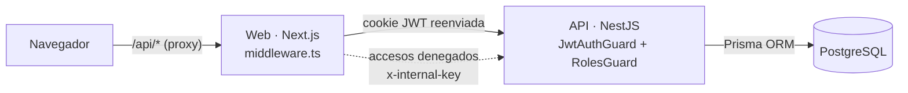
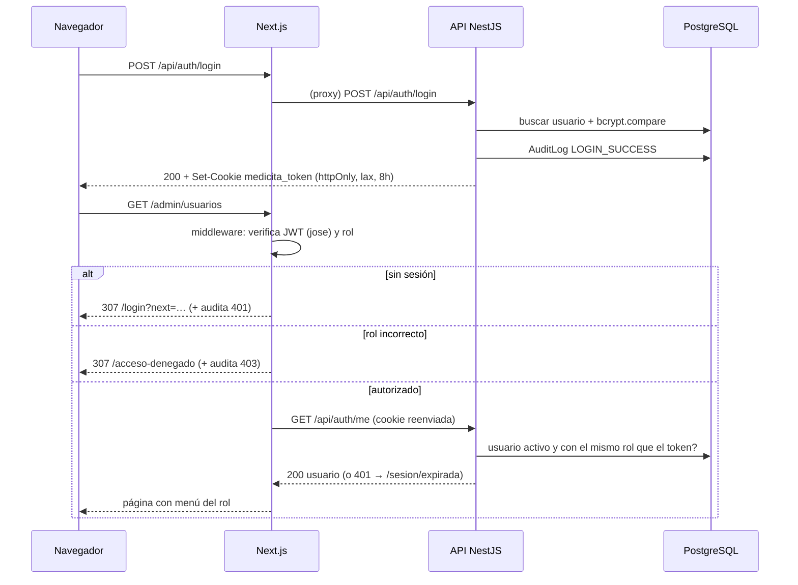
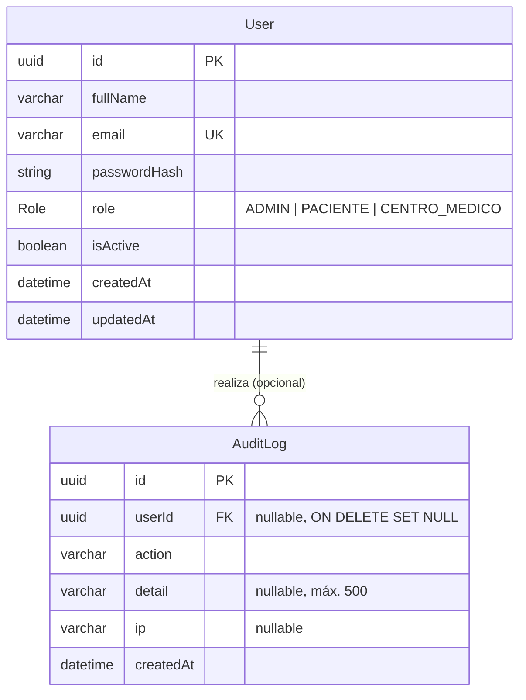

# Arquitectura: MediCita RD (Épica 1)

## Vista general

```
┌──────────────┐  /api/* (mismo origen)   ┌─────────────────────┐  HTTP + cookie   ┌──────────────────┐   Prisma   ┌──────────────┐
│  Navegador   │ ───────────────────────▶ │  Web · Next.js 15   │ ───────────────▶ │  API · NestJS 11 │ ─────────▶ │ PostgreSQL 16│
│ (cookie JWT  │ ◀─────────────────────── │  :3000              │ ◀─────────────── │  :4000/api       │ ◀───────── │  (Docker)    │
│  httpOnly)   │      páginas por rol     │  middleware.ts      │   JSON           │  Guards + Prisma │            │  medicita    │
└──────────────┘                          └─────────────────────┘                  └──────────────────┘            └──────────────┘
                                            │  POST /api/audit/access-denied (x-internal-key)  ▲
                                            └──────────────────────────────────────────────────┘
```



- **Proxy del mismo origen:** el navegador solo habla con `localhost:3000`. Next reenvía `/api/*` a la API (`rewrites` en `next.config.ts`), así que la cookie `httpOnly` pertenece al dominio de la web y el `middleware.ts` puede leerla. La API además tiene CORS configurado para `WEB_URL` con `credentials`.
- **Defensa en dos capas:** el middleware de Next filtra las páginas (experiencia de usuario y primera barrera), y la API vuelve a validar sesión y rol en **cada** petición. Ninguna regla depende solo del frontend.

## Flujo de autenticación



**Invalidación inmediata:** `JwtAuthGuard` consulta al usuario en la base en cada petición. Si está desactivado o su rol ya no coincide con el del token, responde 401 y borra la cookie. La web lo envía a `/sesion/expirada`, que limpia la cookie y redirige al login con un aviso.

## Módulos

### API (`apps/api/src`)

| Módulo | Responsabilidad |
|---|---|
| `auth/` | Registro, login, logout y `me`. `AuthService` (bcrypt, JWT, cookie), decoradores `@Public()`, `@Roles()` y `@CurrentUser()`, guards globales `JwtAuthGuard` (401) y `RolesGuard` (403), matriz `ROLE_PERMISSIONS`. |
| `users/` | Gestión de usuarios para el admin: listar y buscar, cambiar rol, activar y desactivar. Reglas: no modificarse a sí mismo; siempre al menos un admin activo (transacción `Serializable`). |
| `audit/` | `AuditService.record()` (nunca rompe la operación auditada) y `find()` con filtros; `GET /audit`; `POST /audit/access-denied` protegido por `InternalKeyGuard` (comparación en tiempo constante). |
| `modules/` | Endpoints provisionales `/modules/paciente` y `/modules/centro`, restringidos por rol. |
| `prisma/` | `PrismaService` global. |
| `common/` | Política de contraseñas, paginación y utilidades de petición (IP y descripción). |
| `config/` | Validación de variables de entorno al arrancar. |
| `setup.ts` | Configuración HTTP común a `main.ts` y a las e2e: `helmet`, `cookie-parser`, prefijo `/api`, CORS, `ValidationPipe` (`whitelist` + `forbidNonWhitelisted`) y `trust proxy` en loopback. |

### Web (`apps/web/src`)

| Ruta o archivo | Contenido |
|---|---|
| `middleware.ts` | Verifica el JWT con `jose` (mismo `JWT_SECRET`), aplica `ROUTE_RULES` por prefijo, redirige a login (401) o a acceso denegado (403) y reporta ambos casos a la API con `x-internal-key`. |
| `app/page.tsx` | Inicio y bienvenida (pública). |
| `app/(auth)/login`, `app/(auth)/registro` | Iniciar sesión y Crear cuenta (selector Paciente o Centro médico; validación en vivo de la contraseña). |
| `app/acceso-denegado` | Pantalla 403. |
| `app/sesion/expirada` | Route handler que borra la cookie y vuelve al login. |
| `app/(app)/layout.tsx` | Área autenticada: consulta `/auth/me` y pinta `AppShell` (barra lateral o menú de celular según el rol). |
| `app/(app)/paciente/*` | Mis citas, Buscar médico, Pagos (provisionales). |
| `app/(app)/centro/*` | Agenda del centro, Médicos y horarios (provisionales). |
| `app/(app)/admin/usuarios` | Usuarios y roles (funcional, con diálogos de confirmación). |
| `app/(app)/admin/auditoria` | Auditoría (funcional, con filtros por acción, usuario y fechas). |
| `lib/roles.ts` | Roles, etiquetas, página de inicio por rol, menú por rol y reglas de rutas. |
| `lib/api-client.ts`, `lib/api-server.ts` | `fetch` del navegador (mismo origen) y del servidor (reenvía la cookie). |

## Endpoints

Prefijo: `http://localhost:4000/api` (o `/api` desde la web mediante el proxy).

| Método | Ruta | Acceso | Descripción | Respuestas |
|---|---|---|---|---|
| GET | `/health` | Público | Estado de la API. | 200 |
| POST | `/auth/register` | Público | `{fullName, email, password, role: PACIENTE \| CENTRO_MEDICO}`. Crea la cuenta e inicia sesión. | 201, 400, 409 |
| POST | `/auth/login` | Público | `{email, password}`. Emite la cookie `medicita_token`. | 200, 400, 401, 403 (desactivado) |
| POST | `/auth/logout` | Público* | Borra la cookie; audita si el token es válido. | 200 |
| GET | `/auth/me` | Autenticado | Usuario actual, rol y permisos. | 200, 401 |
| GET | `/users?search=&role=&status=&page=&pageSize=` | ADMIN | Lista paginada de usuarios (sin `passwordHash`). | 200, 400, 401, 403 |
| GET | `/users/roles` | ADMIN | Catálogo de roles con permisos. | 200, 401, 403 |
| PATCH | `/users/:id/role` | ADMIN | `{role}`. Cambia el rol (no a sí mismo ni al último admin activo). | 200, 400, 401, 403, 404, 409 |
| PATCH | `/users/:id/status` | ADMIN | `{isActive}`. Activa o desactiva (mismas reglas). | 200, 400, 401, 403, 404, 409 |
| GET | `/audit?action=&user=&from=&to=&page=&pageSize=` | ADMIN | Eventos de auditoría filtrados, del más reciente al más antiguo. | 200, 400, 401, 403 |
| POST | `/audit/access-denied` | Clave interna | `{path, status: 401\|403, userId?, role?, ip?}`, enviado por el middleware de Next. | 204, 400, 401 |
| GET | `/modules/paciente` | PACIENTE | Módulo provisional. | 200, 401, 403 |
| GET | `/modules/centro` | CENTRO_MEDICO | Módulo provisional. | 200, 401, 403 |

\* Es pública para poder borrar la cookie aunque el token ya haya expirado.

Formato de error (NestJS): `{ "statusCode": 403, "error": "Forbidden", "message": "Acceso denegado: tu perfil no tiene permiso para este recurso." }`. Los errores de validación devuelven `message` como arreglo.

## Modelo de datos



- **Role:** enum `ADMIN`, `PACIENTE`, `CENTRO_MEDICO`. Índice por `role`.
- **AuditLog:** índices por `action`, `userId` y `createdAt`. `userId` es el **actor** (quien hizo la acción); el usuario afectado aparece en `detail`. El filtro "usuario" de la auditoría busca en ambos.
- **Acciones auditadas:** `REGISTER`, `LOGIN_SUCCESS`, `LOGIN_FAILED`, `LOGOUT`, `ROLE_CHANGED`, `USER_ACTIVATED`, `USER_DEACTIVATED`, `ACCESS_DENIED_401`, `ACCESS_DENIED_403`.
- Esquema: [apps/api/prisma/schema.prisma](../apps/api/prisma/schema.prisma). Migraciones: `apps/api/prisma/migrations/`.

## Decisiones técnicas

| Decisión | Motivo |
|---|---|
| JWT en una cookie `httpOnly` (no en `localStorage`) | El JavaScript de la página no puede leer el token (mitiga XSS). `sameSite=lax` mitiga CSRF y `secure` se activa en producción. |
| Proxy `/api/*` en Next | Cookie del mismo origen: el middleware puede leerla y no hacen falta cookies entre dominios. |
| Verificar el usuario en la base en cada petición | Desactivar o cambiar el rol tiene efecto inmediato, aunque el JWT siga vigente. |
| Mensaje genérico en el login y bcrypt de relleno para correos inexistentes | No revela qué correos están registrados. |
| La auditoría nunca lanza errores | Un fallo al registrar el evento se reporta en el log, pero no tumba el login ni el cambio de rol. |
| Clave interna para `/audit/access-denied` | Solo el middleware puede reportar denegaciones web; nadie puede llenar la auditoría manualmente. |
| Base `medicita_test` separada | Las e2e corren contra PostgreSQL real sin tocar los datos de desarrollo. |
| Seed idempotente desde variables de entorno | No hay contraseñas privilegiadas fijas en el código, y la demo se puede restablecer. |
| Next.js 15 con `middleware.ts` | Lo pide la especificación (en Next 16 el archivo se renombró a `proxy.ts`). |

## Fuera de alcance (próximas épicas)

Citas, búsqueda de médicos, pagos en línea, agenda del centro, bloqueo por intentos fallidos, verificación de correo, recuperación de contraseña, MFA, revocación de tokens en el servidor y despliegue.
