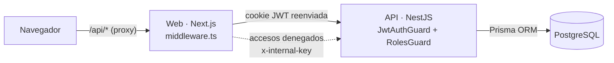
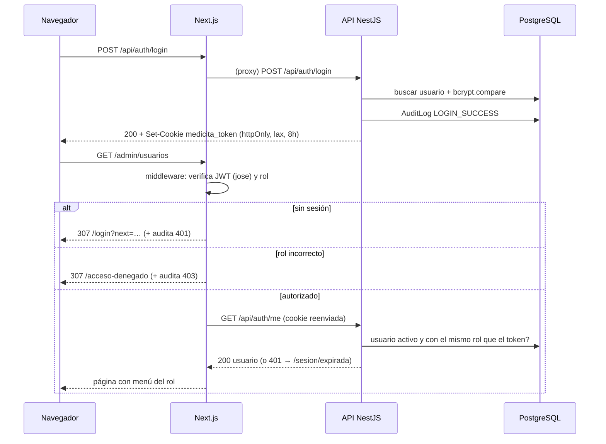
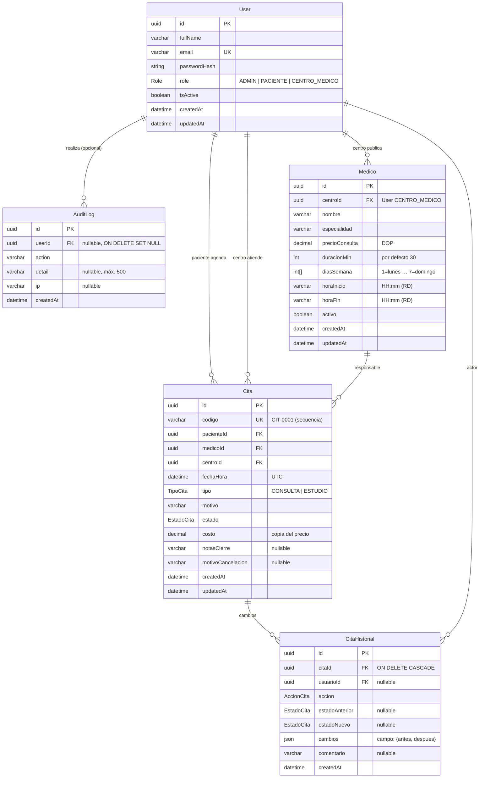
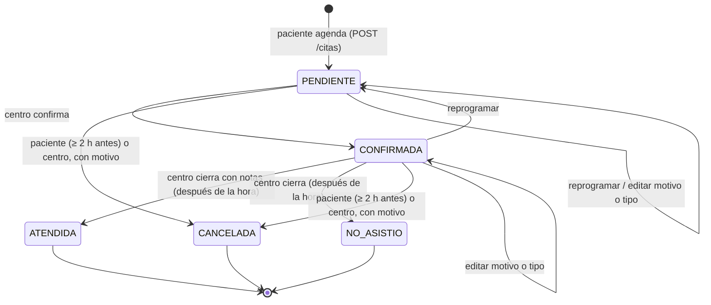
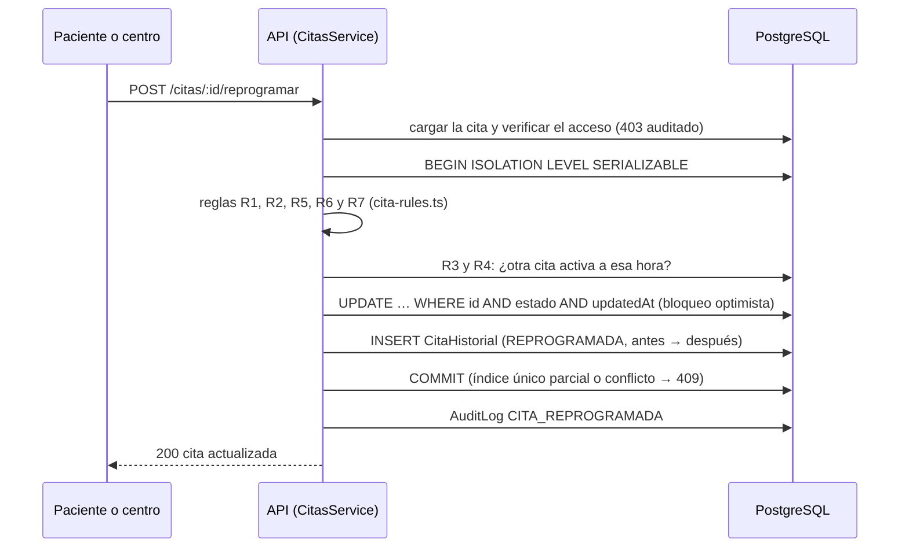

# Arquitectura: MediCita RD (Épicas 1 y 2)

## Vista general

```
┌──────────────┐  /api/* (mismo origen)   ┌─────────────────────┐  HTTP + cookie   ┌──────────────────┐   Prisma   ┌──────────────┐
│  Navegador   │ ───────────────────────▶ │  Web · Next.js 15   │ ───────────────▶ │  API · NestJS 11 │ ─────────▶ │ PostgreSQL 16│
│ (cookie JWT  │ ◀─────────────────────── │  :3000              │ ◀─────────────── │  :4000/api       │ ◀───────── │  (Docker)    │
│  httpOnly)   │      páginas por rol     │  middleware.ts      │   JSON           │  Guards + Prisma │            │  medicita    │
└──────────────┘                          └─────────────────────┘                  └──────────────────┘            └──────────────┘
                                            │  POST /api/audit/access-denied (x-internal-key)  ▲
                                            └──────────────────────────────────────────────────┘
```



- **Proxy del mismo origen:** el navegador solo habla con `localhost:3000`. Next reenvía `/api/*` a la API (`rewrites` en `next.config.ts`), así que la cookie `httpOnly` pertenece al dominio de la web y el `middleware.ts` puede leerla. La API además tiene CORS configurado para `WEB_URL` con `credentials`.
- **Defensa en dos capas:** el middleware de Next filtra las páginas (experiencia de usuario y primera barrera), y la API vuelve a validar sesión y rol en **cada** petición. Ninguna regla depende solo del frontend.

## Flujo de autenticación



**Invalidación inmediata:** `JwtAuthGuard` consulta al usuario en la base en cada petición. Si está desactivado o su rol ya no coincide con el del token, responde 401 y borra la cookie. La web lo envía a `/sesion/expirada`, que limpia la cookie y redirige al login con un aviso.

## Módulos

### API (`apps/api/src`)

| Módulo | Responsabilidad |
|---|---|
| `auth/` | Registro, login, logout y `me`. `AuthService` (bcrypt, JWT, cookie), decoradores `@Public()`, `@Roles()` y `@CurrentUser()`, guards globales `JwtAuthGuard` (401) y `RolesGuard` (403), matriz `ROLE_PERMISSIONS`. |
| `users/` | Gestión de usuarios para el admin: listar y buscar, cambiar rol, activar y desactivar. Reglas: no modificarse a sí mismo; siempre al menos un admin activo (transacción `Serializable`). |
| `audit/` | `AuditService.record()` (nunca rompe la operación auditada) y `find()` con filtros; `GET /audit`; `POST /audit/access-denied` protegido por `InternalKeyGuard` (comparación en tiempo constante). |
| `modules/` | Endpoints provisionales `/modules/paciente` y `/modules/centro`, restringidos por rol (se conservan para las pruebas de acceso de la Épica 1). |
| `medicos/` | **Épica 2.** CRUD de médicos del centro, búsqueda por especialidad, catálogo de especialidades y disponibilidad por día. |
| `citas/` | **Épica 2.** `cita-rules.ts`: reglas R1 a R9 como funciones puras. `CitasService`: crear, listar con filtros, detalle, PATCH, reprogramar, confirmar, cerrar, cancelar e historial; control de acceso por rol (403 auditado); transacción `Serializable` con historial en la misma transacción y bloqueo optimista. |
| `reportes/` | **Épica 2.** Reporte de citas (totales por estado, por médico y por día, tasas e ingresos) en JSON y CSV. |
| `prisma/` | `PrismaService` global. |
| `common/` | Política de contraseñas, paginación, utilidades de petición (IP y descripción) y `rd-time.ts` (fechas en hora de República Dominicana, UTC−4). |
| `config/` | Validación de variables de entorno al arrancar. |
| `setup.ts` | Configuración HTTP común a `main.ts` y a las e2e: `helmet`, `cookie-parser`, prefijo `/api`, CORS, `ValidationPipe` (`whitelist` + `forbidNonWhitelisted`) y `trust proxy` en loopback. |

### Web (`apps/web/src`)

| Ruta o archivo | Contenido |
|---|---|
| `middleware.ts` | Verifica el JWT con `jose` (mismo `JWT_SECRET`), aplica `ROUTE_RULES` por prefijo, redirige a login (401) o a acceso denegado (403) y reporta ambos casos a la API con `x-internal-key`. |
| `app/page.tsx` | Inicio y bienvenida (pública). |
| `app/(auth)/login`, `app/(auth)/registro` | Iniciar sesión y Crear cuenta (selector Paciente o Centro médico; validación en vivo de la contraseña). |
| `app/acceso-denegado` | Pantalla 403. |
| `app/sesion/expirada` | Route handler que borra la cookie y vuelve al login. |
| `app/(app)/layout.tsx` | Área autenticada: consulta `/auth/me` y pinta `AppShell` (barra lateral o menú de celular según el rol). |
| `app/(app)/paciente/citas`, `citas/[id]` | Mis citas (Próximas e Historial) y detalle con historial, reprogramar, editar y cancelar. |
| `app/(app)/paciente/buscar-medico`, `buscar-medico/[id]` | Búsqueda por especialidad, y perfil del médico con selector de turnos libres y confirmación con resumen y costo. |
| `app/(app)/paciente/pagos` | Pagos (provisional). |
| `app/(app)/centro/agenda`, `agenda/[id]` | Agenda del centro con filtros, y detalle con confirmar, reprogramar, cerrar, cancelar y la línea de tiempo. |
| `app/(app)/centro/medicos` | Médicos y horarios (CRUD, activar y desactivar). |
| `app/(app)/centro/reportes`, `reportes/imprimir` | Reporte de su centro y vista imprimible. |
| `app/(app)/admin/usuarios` | Usuarios y roles (funcional, con diálogos de confirmación). |
| `app/(app)/admin/auditoria` | Auditoría (funcional, con filtros por acción, usuario y fechas). |
| `app/(app)/admin/operaciones`, `operaciones/[id]` | Todas las citas con filtros por estado, fecha, centro y médico; detalle de solo lectura. |
| `app/(app)/admin/reportes`, `reportes/imprimir` | Reporte global, descarga CSV y vista imprimible. |
| `components/citas/*` | Insignia de estado, selector de turnos, tabla de citas con filtros, detalle con diálogos de acción y línea de tiempo del historial. |
| `components/reportes/*` | Tarjetas, gráficos de barras (CSS, sin dependencias), tabla por médico y vista imprimible. |
| `lib/citas.ts` | Tipos, colores y etiquetas de estado, y formato de fechas (zona `America/Santo_Domingo`) y de DOP. |
| `lib/roles.ts` | Roles, etiquetas, página de inicio por rol, menú por rol y reglas de rutas. |
| `lib/api-client.ts`, `lib/api-server.ts` | `fetch` del navegador (mismo origen) y del servidor (reenvía la cookie). |

## Endpoints

Prefijo: `http://localhost:4000/api` (o `/api` desde la web mediante el proxy).

| Método | Ruta | Acceso | Descripción | Respuestas |
|---|---|---|---|---|
| GET | `/health` | Público | Estado de la API. | 200 |
| POST | `/auth/register` | Público | `{fullName, email, password, role: PACIENTE \| CENTRO_MEDICO}`. Crea la cuenta e inicia sesión. | 201, 400, 409 |
| POST | `/auth/login` | Público | `{email, password}`. Emite la cookie `medicita_token`. | 200, 400, 401, 403 (desactivado) |
| POST | `/auth/logout` | Público* | Borra la cookie; audita si el token es válido. | 200 |
| GET | `/auth/me` | Autenticado | Usuario actual, rol y permisos. | 200, 401 |
| GET | `/users?search=&role=&status=&page=&pageSize=` | ADMIN | Lista paginada de usuarios (sin `passwordHash`). | 200, 400, 401, 403 |
| GET | `/users/roles` | ADMIN | Catálogo de roles con permisos. | 200, 401, 403 |
| PATCH | `/users/:id/role` | ADMIN | `{role}`. Cambia el rol (no a sí mismo ni al último admin activo). | 200, 400, 401, 403, 404, 409 |
| PATCH | `/users/:id/status` | ADMIN | `{isActive}`. Activa o desactiva (mismas reglas). | 200, 400, 401, 403, 404, 409 |
| GET | `/audit?action=&user=&from=&to=&page=&pageSize=` | ADMIN | Eventos de auditoría filtrados, del más reciente al más antiguo. | 200, 400, 401, 403 |
| POST | `/audit/access-denied` | Clave interna | `{path, status: 401\|403, userId?, role?, ip?}`, enviado por el middleware de Next. | 204, 400, 401 |
| GET | `/modules/paciente` | PACIENTE | Módulo provisional. | 200, 401, 403 |
| GET | `/modules/centro` | CENTRO_MEDICO | Módulo provisional. | 200, 401, 403 |

\* Es pública para poder borrar la cookie aunque el token ya haya expirado.

### Épica 2: médicos, citas y reportes

| Método | Ruta | Acceso | Descripción | Respuestas |
|---|---|---|---|---|
| GET | `/medicos?especialidad=&texto=&centroId=&page=&pageSize=` | Autenticado | Busca médicos. El paciente ve los activos, el centro solo los suyos (también inactivos) y el admin todos. | 200, 400, 401 |
| GET | `/medicos/especialidades` | Autenticado | Especialidades disponibles (para el filtro de búsqueda). | 200, 401 |
| GET | `/medicos/:id` | Autenticado | Perfil del médico (horario, duración y precio). | 200, 401, 403, 404 |
| GET | `/medicos/:id/disponibilidad?fecha=AAAA-MM-DD` | Autenticado | Turnos del día con `disponible` y `motivo` (`ocupado`, `pasado` o `fuera de rango`). | 200, 400, 401, 403, 404 |
| POST | `/medicos` | CENTRO_MEDICO | `{nombre, especialidad, precioConsulta, duracionMin?, diasSemana[], horaInicio, horaFin}`. | 201, 400, 401, 403 |
| PATCH | `/medicos/:id` | CENTRO_MEDICO (dueño) | Edita cualquier campo de los anteriores. | 200, 400, 401, 403, 404 |
| PATCH | `/medicos/:id/estado` | CENTRO_MEDICO (dueño) | `{activo}`: activa o desactiva. | 200, 400, 401, 403, 404 |
| POST | `/citas` | PACIENTE | `{medicoId, fechaHora (ISO 8601), tipo?, motivo}`. Aplica R1 a R5 y R10. | 201, 400, 401, 403, 404, 409 |
| GET | `/citas?estado=A,B&desde=&hasta=&medicoId=&centroId=&pacienteId=&texto=&orden=asc\|desc&page=&pageSize=` | Autenticado (alcance por rol) | Lista paginada y ordenada por fecha. El paciente ve las suyas, el centro las de su centro y el admin todas. | 200, 400, 401 |
| GET | `/citas/:id` | Dueño, su centro o admin | Detalle de la cita. | 200, 401, 403, 404 |
| GET | `/citas/:id/historial` | Dueño, su centro o admin | Historial completo en orden cronológico. | 200, 401, 403, 404 |
| PATCH | `/citas/:id` | PACIENTE (dueño) o CENTRO_MEDICO (de la cita) | `{motivo?, tipo?}` (R7). | 200, 400, 401, 403, 404, 409 |
| POST | `/citas/:id/reprogramar` | PACIENTE o CENTRO_MEDICO | `{fechaHora, comentario?}`. Vuelve a Pendiente (R1 a R7, R10). | 200, 400, 401, 403, 404, 409 |
| POST | `/citas/:id/confirmar` | CENTRO_MEDICO | `{comentario?}`. Pendiente → Confirmada. | 200, 401, 403, 404, 409 |
| POST | `/citas/:id/cerrar` | CENTRO_MEDICO | `{resultado: ATENDIDA\|NO_ASISTIO, notas?}` (R9). | 200, 400, 401, 403, 404, 409 |
| POST | `/citas/:id/cancelar` | PACIENTE o CENTRO_MEDICO | `{motivo}` (R8). | 200, 400, 401, 403, 404, 409 |
| GET | `/reportes/citas?desde=&hasta=&centroId=&medicoId=` | ADMIN (global) o CENTRO_MEDICO (su centro) | `{total, porEstado, tasaAsistencia, tasaCancelacion, ingresos, porMedico[], porDia[]}`. | 200, 400, 401, 403 |
| GET | `/reportes/citas.csv?…` | ADMIN o CENTRO_MEDICO | El mismo reporte en CSV (UTF-8 con BOM): resumen, por médico, por día y detalle. | 200, 400, 401, 403 |

Códigos de las reglas de negocio: **400** cuando el dato no es válido (R1, R2, R5, R8 y R9) y **409** cuando hay conflicto con el estado actual o con otra cita (R3, R4, R6, R7 y R10). Si alguien intenta acceder a una cita o un médico de otro usuario, la API responde **403** "Acceso denegado: esta cita no te pertenece." y lo audita como `ACCESS_DENIED_403`.

Formato de error (NestJS): `{ "statusCode": 403, "error": "Forbidden", "message": "Acceso denegado: tu perfil no tiene permiso para este recurso." }`. Los errores de validación devuelven `message` como arreglo.

## Modelo de datos



- **Role:** enum `ADMIN`, `PACIENTE`, `CENTRO_MEDICO`. Índice por `role`.
- **AuditLog:** índices por `action`, `userId` y `createdAt`. `userId` es el **actor** (quien hizo la acción); el usuario afectado aparece en `detail`. El filtro "usuario" de la auditoría busca en ambos.
- **Acciones auditadas:** `REGISTER`, `LOGIN_SUCCESS`, `LOGIN_FAILED`, `LOGOUT`, `ROLE_CHANGED`, `USER_ACTIVATED`, `USER_DEACTIVATED`, `ACCESS_DENIED_401`, `ACCESS_DENIED_403` y, desde la Épica 2, `MEDICO_CREADO`, `MEDICO_ACTUALIZADO`, `MEDICO_ACTIVADO`, `MEDICO_DESACTIVADO`, `CITA_CREADA`, `CITA_ACTUALIZADA`, `CITA_REPROGRAMADA`, `CITA_CONFIRMADA`, `CITA_CERRADA` y `CITA_CANCELADA`.
- **Medico:** índices por `centroId` y `especialidad`. El horario se interpreta en hora de RD.
- **Cita:** índices por `estado`, `fechaHora`, `medicoId`, `centroId` y `pacienteId`. `codigo` lo genera la base con la secuencia `Cita_codigo_seq`. Además hay **dos índices únicos parciales** (en SQL, porque Prisma no los modela): `(medicoId, fechaHora)` y `(pacienteId, fechaHora)` `WHERE estado IN ('PENDIENTE','CONFIRMADA')`. Son la última barrera de R3, R4 y R10.
- **CitaHistorial:** índice por `(citaId, createdAt)`. Se escribe en la **misma transacción** que el cambio de la cita.
- **AccionCita:** `CREADA`, `ACTUALIZADA`, `REPROGRAMADA`, `CONFIRMADA`, `CERRADA`, `CANCELADA`.
- Esquema: [apps/api/prisma/schema.prisma](../apps/api/prisma/schema.prisma). Migraciones: `apps/api/prisma/migrations/` (`20261103055551_init` y `20261104120000_epica2_citas`).

## Ciclo de vida de la cita (estados)



- **Estados activos:** `PENDIENTE` y `CONFIRMADA`. Ocupan el turno del médico y del paciente.
- **Estados cerrados:** `ATENDIDA`, `NO_ASISTIO` y `CANCELADA`. No se pueden modificar (R7) y liberan el turno.
- Cualquier transición que no está en el diagrama responde **409** (R6).

### Flujo de una operación sobre la cita



## Decisiones técnicas

| Decisión | Motivo |
|---|---|
| JWT en una cookie `httpOnly` (no en `localStorage`) | El JavaScript de la página no puede leer el token (mitiga XSS). `sameSite=lax` mitiga CSRF y `secure` se activa en producción. |
| Proxy `/api/*` en Next | Cookie del mismo origen: el middleware puede leerla y no hacen falta cookies entre dominios. |
| Verificar el usuario en la base en cada petición | Desactivar o cambiar el rol tiene efecto inmediato, aunque el JWT siga vigente. |
| Mensaje genérico en el login y bcrypt de relleno para correos inexistentes | No revela qué correos están registrados. |
| La auditoría nunca lanza errores | Un fallo al registrar el evento se reporta en el log, pero no tumba el login ni el cambio de rol. |
| Clave interna para `/audit/access-denied` | Solo el middleware puede reportar denegaciones web; nadie puede llenar la auditoría manualmente. |
| Base `medicita_test` separada | Las e2e corren contra PostgreSQL real sin tocar los datos de desarrollo. |
| Seed idempotente desde variables de entorno | No hay contraseñas privilegiadas fijas en el código, y la demo se puede restablecer. |
| Next.js 15 con `middleware.ts` | Lo pide la especificación (en Next 16 el archivo se renombró a `proxy.ts`). |
| **Épica 2:** fechas en UTC y horarios en hora de RD (UTC−4 fijo) | RD no tiene horario de verano, así que basta un desfase fijo (`common/rd-time.ts`). Así la regla R2 no depende de la zona horaria del servidor ni del navegador; la web formatea con `America/Santo_Domingo`. |
| **Épica 2:** reglas como funciones puras (`cita-rules.ts`) | Cada regla tiene su prueba unitaria sin base de datos, y el servicio las reutiliza dentro de la transacción. |
| **Épica 2:** R10 en dos capas | Transacción `Serializable` (si dos reservas compiten, Postgres aborta una con P2034) más índices únicos parciales (P2002). Las dos se convierten en 409. En los cambios de estado, `updateMany … WHERE estado AND updatedAt` evita que dos personas pisen la misma cita. |
| **Épica 2:** historial en la misma transacción y auditoría después | Si la regla falla, no queda historial a medias. La auditoría general sigue la política de la Épica 1: nunca rompe la operación. |
| **Épica 2:** el costo se copia al crear la cita | Si el centro cambia el precio después, las citas existentes y los ingresos del reporte no cambian. |
| **Épica 2:** código `CIT-0001` generado por la base | Una secuencia de PostgreSQL no repite códigos aunque haya inserciones simultáneas. |
| **Épica 2:** gráficos con CSS, sin librería | Menos dependencias, y se imprimen bien. Los colores de estado son los pedidos (amarillo, azul, verde, gris y rojo), siempre con etiqueta y valor visibles y una tabla equivalente. |
| **Épica 2:** CSV con BOM y celdas protegidas | Abre bien en Excel con acentos, y los valores que empiezan con `=`, `+`, `-` o `@` se neutralizan (inyección de fórmulas). |

## Fuera de alcance (próximas épicas)

Pagos en línea, notificaciones y recordatorios, feriados y excepciones de horario del médico, lista de espera, bloqueo por intentos fallidos, verificación de correo, recuperación de contraseña, MFA, revocación de tokens en el servidor y despliegue.
